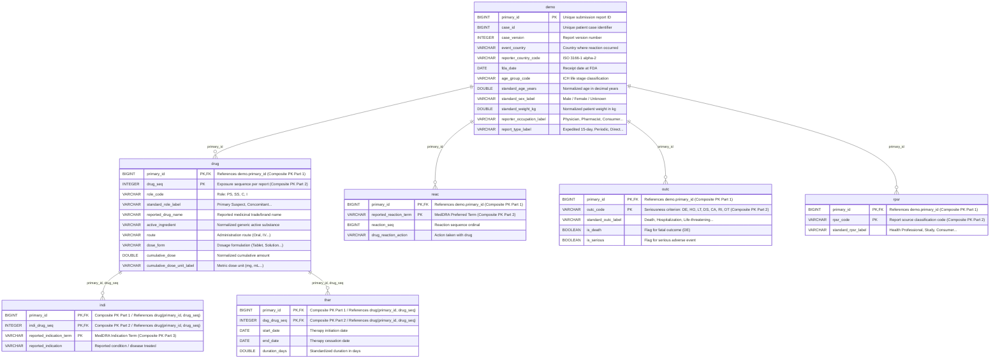

# Canonical Entity-Relationship (ER) Diagram

Visual representation of the **7 canonical pharmacovigilance fact tables**, composite keys, and entity relationships in `raxtik-etl`.

---

## 🏛️ Visual Schema Model

---

## 🔑 Composite Primary Keys & Relational Cardinality

| Table | Entity / Domain | Primary Key (Composite) | Foreign Key Relationship | Cardinality | Description |
| :--- | :--- | :--- | :--- | :--- | :--- |
| **`demo`** | Case Submissions & Demographics | `primary_id` | *(Root submission table)* | Root | Individual patient report submission with demographic covariates. |
| **`drug`** | Drug Exposures & Regimens | `(primary_id, drug_seq)` | `primary_id` → `demo.primary_id` | 1 : N | Reported medicinal products, active ingredients, dosage forms, and suspect roles. |
| **`reac`** | Adverse Reactions | `(primary_id, reported_reaction_term)` | `primary_id` → `demo.primary_id` | 1 : N | Adverse reaction terms coded with MedDRA Preferred Terms (`reported_reaction_term`). |
| **`outc`** | Patient Outcomes | `(primary_id, outc_code)` | `primary_id` → `demo.primary_id` | 1 : N | Clinical seriousness criteria (`DE`, `HO`, `LT`, `DS`, `CA`, `RI`, `OT`). |
| **`indi`** | Therapy Indications | `(primary_id, indi_drug_seq, reported_indication_term)` | `(primary_id, indi_drug_seq)` → `drug(primary_id, drug_seq)` | 1 : N | Medical conditions and clinical indications for which each drug was prescribed. |
| **`ther`** | Therapy Timelines | `(primary_id, dsg_drug_seq)` | `(primary_id, dsg_drug_seq)` → `drug(primary_id, drug_seq)` | 1 : N | Start dates, end dates, and standardized therapy durations in days. |
| **`rpsr`** | Report Sources | `(primary_id, rpsr_code)` | `primary_id` → `demo.primary_id` | 1 : N | Reporting source categories (Physician, Pharmacist, Consumer, Study). |
| **`cases`** | Authoritative Deduplicated View | `case_id` | Derived from `demo` | 1 : 1 | Precomputed view resolving multi-version follow-ups to latest report version. |

---

## 📖 Related Documentation

- **[Architecture & Engine Design](docs/architecture.md)**
- **[Canonical Data Model Specification](docs/schema/canonical_data_model.md)**
- **[Coded Values Reference](docs/schema/code_list_history.md)**
- **[ReadTheDocs Interactive Documentation](https://raxtik-etl.readthedocs.io/en/latest/)**
